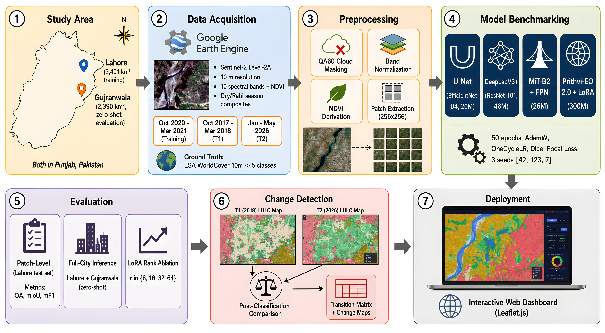
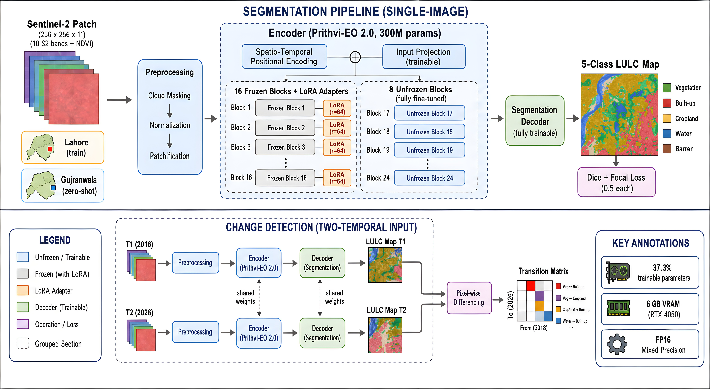
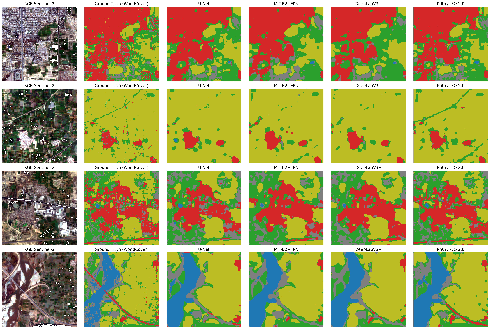
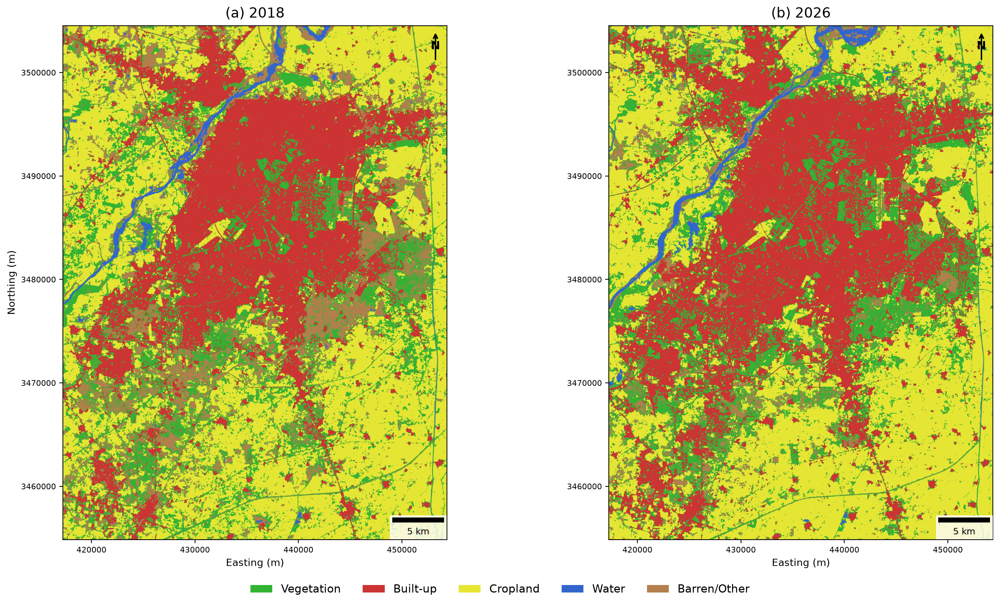

<div align="center">

# Parameter-Efficient Adaptation of an Earth Observation Foundation Model for Land Cover Mapping

[](https://python.org)
[](https://pytorch.org)
[](LICENSE)
[](https://www.sciencedirect.com/journal/computers-and-geosciences)
[](#data)

**A reproducible pipeline for adapting a 300M-parameter earth observation foundation model to land cover segmentation on consumer-grade hardware (6 GB VRAM).**

[Paper (under review)](#citation) | [Live Dashboard](https://greenwatch-dashboard.vercel.app) | [Getting Started](#setup)

</div>

---

## Overview

This repository implements a parameter-efficient pipeline for adapting **NASA/IBM Prithvi-EO 2.0** (300M params) via **LoRA + selective block unfreezing** for 5-class land cover segmentation over **Lahore, Pakistan** using 11-band Sentinel-2 imagery, benchmarked against U-Net, DeepLabV3+, and MiT-B2+FPN. Zero-shot cross-city transfer is evaluated on **Gujranwala** without retraining.

<div align="center">

<br/>
<em>Figure 1: End-to-end methodology -- from data acquisition through model benchmarking to change detection and deployment.</em>
</div>

---

## Key Findings

| | Finding | Detail |
|---|---------|--------|
| 1 | **Prithvi wins on all metrics** | +1.86 pp mIoU over the best baseline across 3 seeds |
| 2 | **Zero-shot transfer works** | +3.02 pp mIoU on Gujranwala without any retraining |
| 3 | **LoRA is efficient** | Only 37.3% of parameters are trainable (120.1M of 321.6M) |
| 4 | **Runs on consumer hardware** | All training on a single RTX 4050 (6 GB VRAM) with FP16 mixed precision |
| 5 | **Urbanization quantified** | +107.5 km2 built-up expansion in Lahore between 2018 and 2026 |

---

## Architecture

<div align="center">

<br/>
<em>Figure 2: Prithvi-EO 2.0 adaptation -- 16 frozen blocks with LoRA (r=64) + 8 fully unfrozen blocks + trainable decoder.</em>
</div>

---

## Results

### Multi-Seed Patch-Level Evaluation (Lahore test set, seeds 42/123/7)

| Model | Encoder | Params | OA (%) | mIoU (%) | mF1 (%) |
|:------|:--------|-------:|-------:|---------:|--------:|
| U-Net | EfficientNet-B4 | 20M | 81.18 +/- 0.09 | 59.16 +/- 0.07 | 72.85 +/- 0.06 |
| MiT-B2 + FPN | MiT-B2 | 26M | 80.61 +/- 0.12 | 59.07 +/- 0.07 | 72.73 +/- 0.03 |
| DeepLabV3+ | ResNet-101 | 46M | 80.81 +/- 0.06 | 59.05 +/- 0.17 | 72.73 +/- 0.14 |
| **Prithvi-EO 2.0** | **ViT + LoRA** | **321.6M** | **82.83 +/- 0.35** | **61.02 +/- 0.45** | **74.53 +/- 0.21** |

### Zero-Shot Cross-City Generalization (seed 42)

| Model | Lahore OA | Lahore mIoU | Gujranwala OA | Gujranwala mIoU |
|:------|----------:|------------:|--------------:|----------------:|
| U-Net | 82.27 | 59.26 | 90.47 | 55.29 |
| DeepLabV3+ | 82.50 | 59.93 | 90.52 | 54.57 |
| MiT-B2 + FPN | 82.25 | 59.35 | 90.48 | 54.71 |
| **Prithvi-EO 2.0** | **84.55** | **62.02** | **91.31** | **58.31** |

### LoRA Rank Ablation

| Rank | Trainable Params | Train % | mIoU (%) | OA (%) |
|-----:|-----------------:|--------:|---------:|-------:|
| 8 | 105.4M | 34.3% | 60.21 | 82.27 |
| 16 | 107.5M | 34.8% | 60.52 | 82.65 |
| 32 | 111.7M | 35.7% | 60.70 | 82.65 |
| **64** | **120.1M** | **37.3%** | **61.24** | **82.90** |

---

## Visual Results

### Prediction Comparison (Lahore test patches)

<div align="center">

<br/>
<em>Qualitative comparison: RGB input, ground truth, and predictions from all four models.</em>
</div>

### Change Detection (2018 - 2026)

<div align="center">

<br/>
<em>Multi-temporal land cover change in Lahore and Gujranwala, detected via post-classification comparison using the best-performing Prithvi model.</em>
</div>

---

## Project Structure

```
prithvi-lulc-punjab/
├── data_download/           # Google Earth Engine export scripts
│   ├── gee_sentinel2_export.js
│   ├── gee_sentinel2_2021_export.js
│   ├── gee_lahore_2026_export.js
│   ├── gee_gujranwala_export.js
│   ├── gee_gujranwala_dryseason_export.js
│   ├── gee_worldcover_export.js
│   └── gee_hansen_export.js
├── preprocessing/
│   └── prepare_patches.py   # Patch extraction (256x256, 70/15/15 stratified split)
├── training/
│   ├── train.py             # Baseline training (U-Net, DeepLabV3+, MiT-B2+FPN)
│   ├── train_prithvi.py     # Prithvi-EO 2.0 + LoRA fine-tuning
│   ├── dataset.py           # 11-band Sentinel-2 dataset loader
│   ├── losses.py            # Dice + Focal loss (0.5 each)
│   ├── run_multiseed.py     # Multi-seed experiment runner (seeds 42, 123, 7)
│   └── run_lora_ablation.py # LoRA rank sweep (r = 8, 16, 32, 64)
├── evaluation/
│   ├── inference.py         # Full-city inference + zero-shot transfer
│   ├── evaluate_true_metrics.py  # OA, mIoU, mF1, per-class metrics
│   ├── significance_tests.py     # Statistical significance analysis
│   └── generate_panel_4models.py # Figure generation
├── webapp/                  # Interactive Leaflet.js dashboard
├── docs/                    # README figures
├── requirements.txt
├── LICENSE
└── README.md
```

---

## Setup

### Requirements

- Python 3.10+
- NVIDIA GPU with 6+ GB VRAM (tested on RTX 4050 Laptop)
- CUDA 11.8+

### Installation

```bash
git clone https://github.com/ZentaCros/prithvi-lulc-punjab.git
cd prithvi-lulc-punjab
pip install -r requirements.txt
```

### Data

All satellite imagery is sourced from [Google Earth Engine](https://earthengine.google.com/):

| Dataset | Source | Resolution | Use |
|---------|--------|-----------|-----|
| Sentinel-2 L2A | Copernicus/ESA | 10 m | 10 spectral bands + NDVI |
| ESA WorldCover 2021 | ESA | 10 m | Ground truth (remapped to 5 classes) |
| Hansen Forest Change | UMD/Google | 30 m | Validation |

**LULC Classes:** Vegetation - Built-up - Cropland - Water - Barren

Run the scripts in `data_download/` to export composites, then download from Google Drive.

### Training

```bash
# Multi-seed baselines (U-Net, DeepLabV3+, MiT-B2+FPN)
python training/run_multiseed.py

# Prithvi-EO 2.0 + LoRA
python training/train_prithvi.py

# LoRA rank ablation
python training/run_lora_ablation.py
```

### Evaluation

```bash
# Full-city inference + zero-shot Gujranwala transfer
python evaluation/inference.py

# Compute metrics
python evaluation/evaluate_true_metrics.py

# Statistical significance
python evaluation/significance_tests.py
```

---

## Models

| Model | Encoder | Total Params | Trainable | Strategy | Library |
|-------|---------|:-----------:|:---------:|----------|---------|
| U-Net | EfficientNet-B4 | 20M | 20M (100%) | Full fine-tune | SMP v0.6.0 |
| DeepLabV3+ | ResNet-101 | 46M | 46M (100%) | Full fine-tune | SMP v0.6.0 |
| MiT-B2 + FPN | MiT-B2 | 26M | 26M (100%) | Full fine-tune | SMP v0.6.0 |
| Prithvi-EO 2.0 | ViT (24 blocks) | 321.6M | 120.1M (37.3%) | LoRA (r=64) + 8 unfrozen blocks | Terratorch + PEFT |

**Training config:** 50 epochs, AdamW optimizer, OneCycleLR scheduler, Dice + Focal loss (0.5 each), batch size 2, FP16 mixed precision.

---

## Web Dashboard

[](https://greenwatch-dashboard.vercel.app)

An interactive Leaflet.js dashboard for exploring LULC maps and change detection results across both cities and all time periods.

**[greenwatch-dashboard.vercel.app](https://greenwatch-dashboard.vercel.app)** | [Source code](https://github.com/ZentaCros/greenwatch-dashboard)

```bash
# Or run locally
cd webapp
python -m http.server 8000
# Open http://localhost:8000
```

---

## Citation

If you use this code or data, please cite:

```bibtex
@article{azeem2026parameter,
  title={Parameter-Efficient Adaptation of an Earth Observation Foundation Model
         for Land Cover Mapping: Hybrid {LoRA} Fine-Tuning Evaluated on
         {Sentinel-2} Imagery in {Punjab}, {Pakistan}},
  author={Azeem, Muhammad Hamza},
  journal={Computers \& Geosciences},
  year={2026},
  note={Under review}
}
```

## License

This project is licensed under the MIT License. See [LICENSE](LICENSE) for details.

---

<div align="center">
<sub>Built with limited resources, unlimited curiosity.</sub>
</div>
